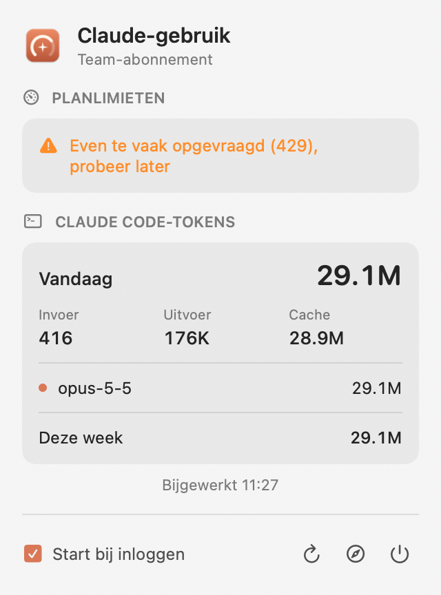
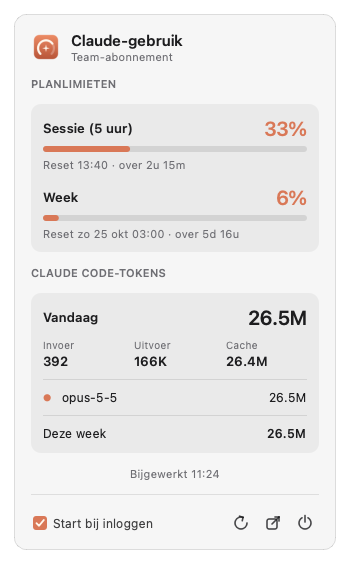

# Claude Usage

Laat je Claude-gebruik altijd zien: in de menubalk van macOS en in de taakbalk van Windows en Ubuntu.

- **Planlimieten:** hoeveel procent je hebt verbruikt van je 5-uurs sessie en je weeklimiet, met de resettijd.
  Dit zijn dezelfde cijfers als `/usage` in Claude Code.
- **Claude Code-tokens:** hoeveel tokens je vandaag en deze week hebt gebruikt, ook per model.
- **Start bij inloggen:** zet je aan of uit met een vinkje in het paneel.

De kleur geeft het niveau aan: terracotta is normaal, oranje vanaf 75% en rood vanaf 90%.

| macOS | Windows / Ubuntu |
|---|---|
|  |  |

## Wat je nodig hebt

- **Claude Code, ingelogd met een claude.ai-account** (Pro, Max, Team of Enterprise). De app gebruikt
  die login om je planlimieten op te vragen. Er is niets extra in te stellen.
  - macOS: de login staat in de Keychain. De eerste keer kan macOS om toestemming vragen. Kies dan
    **Altijd toestaan**.
  - Windows en Ubuntu: de app zoekt de login op alle plekken waar Claude Code of de Claude-app hem
    bewaart: `.credentials.json` in de Claude-configmappen, Windows Credential Manager en de
    sleutelbos van Ubuntu. Staan er meerdere logins, dan kiest hij de geldige die het langst geldig is.
- Geen login gevonden, of is hij verlopen? Klik dan in het paneel op **Inloggen met Claude Code**.
  Er opent een terminal met `claude auth login`. Zodra je bent ingelogd, laadt het paneel vanzelf.
  Op macOS open je Claude Code één keer, dan ververst Claude Code de login zelf.
- Log je in Claude Code in met een API-key, dan zijn er geen planlimieten. De tokens werken wel.

## Installeren

Download het bestand voor je systeem bij de [laatste release](../../releases/latest).

### macOS (13 of nieuwer, Apple Silicon en Intel)

1. Download `ClaudeUsage-macos.zip`, pak het uit en sleep **Claude Usage** naar je map Apps.
2. Bij de eerste keer openen meldt macOS dat de app niet gecontroleerd kan worden, omdat hij niet
   door Apple genotariseerd is. Ga naar **Systeeminstellingen › Privacy en beveiliging** en klik
   onderaan op **Open toch**. Dit kan ook in Terminal:
   ```bash
   xattr -dr com.apple.quarantine "/Applications/Claude Usage.app"
   ```
3. Klik op `✳︎` in de menubalk en vink **Start bij inloggen** aan.

### Windows

1. Download `ClaudeUsage.exe` en zet hem op een vaste plek, bijvoorbeeld `%LOCALAPPDATA%\ClaudeUsage\`.
2. Dubbelklik op de exe. SmartScreen geeft een waarschuwing, omdat de exe niet ondertekend is.
   Kies **Meer informatie › Toch uitvoeren**.
3. Het icoon staat misschien eerst onder het pijltje `^` in de taakbalk. Sleep het naar de taakbalk
   als je het altijd wilt zien.
4. Klik op het icoon en vink **Start bij inloggen** aan.

### Ubuntu (22.04 of nieuwer)

1. Download `ClaudeUsage-ubuntu.tar.gz` en pak het uit:
   ```bash
   mkdir -p ~/.local/bin && tar -xzf ClaudeUsage-ubuntu.tar.gz -C ~/.local/bin
   ```
2. Start de app met `~/.local/bin/ClaudeUsage &`.
3. Klik op het icoon rechtsboven en vink **Start bij inloggen** aan.

Zie je geen icoon? Zet dan de extensie *Ubuntu AppIndicators* aan via *Extensies*.

## Hoe het werkt

- **Planlimieten:** de app vraagt `GET https://api.anthropic.com/api/oauth/usage` op met het
  OAuth-token van Claude Code, elke 10 minuten en als je op verversen klikt. Dit endpoint is
  niet officieel gedocumenteerd. Verandert het, dan toont de app een melding in plaats van cijfers.
- **Te veel verzoeken (429):** het endpoint is streng, en Claude Code vraagt het zelf ook op.
  Na een 429 wacht de app steeds langer: 15, dan 30, dan 60 minuten. Zodra het weer lukt, gaat
  hij terug naar elke 10 minuten. De laatste cijfers blijven staan, met "stand van" erbij, ook na
  een herstart.
- **Tokens:** de app telt de `usage`-velden in `~/.claude/projects/**/*.jsonl`. Dat gebeurt
  elke minuut, alleen met bestanden van deze week en volledig lokaal.
- De app stuurt nergens anders gegevens heen.

## Zelf bouwen

- macOS: [`macos/`](macos/), een Swift-app (AppKit en SwiftUI) zonder afhankelijkheden.
- Windows en Ubuntu: [`tray/`](tray/), één app in Python en Qt (PySide6).

GitHub Actions bouwt bij elke push alle drie de versies, te vinden onder *Actions*.
Een tag zoals `v1.0` maakt een release met de drie bestanden:

```bash
git tag v1.0 && git push origin v1.0
```
